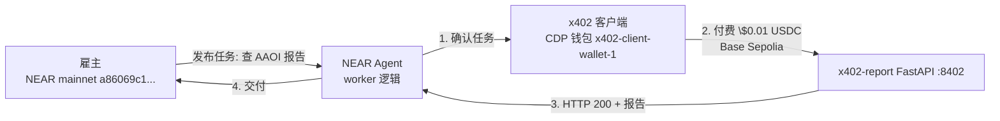

# Near × x402 组合实验（P0）—— 已跑通 ✅

> 目标：验证「NEAR 协调层 + x402 支付层」最小闭环成立——NEAR Agent 收到任务后，通过 x402 协议为数据付费，拿结果并交付。
> 依据：NEAR 是 Coinbase x402 的 launch partner（2025-05），并于 2026-07-14 加入 Linux Foundation 下 x402 Foundation。官方定位：**x402 解决"Agent 怎么付钱"，NEAR 解决"Agent 怎么发现、协调、执行和跨链结算"**。

## 一、目标

跑通一条最小链路，证明两端可以拼接：

```
雇主（NEAR mainnet 账户）发布任务
   → 执行层（组合脚本，模拟 NEAR Agent worker）
   → 触发 x402 付费调用（CDP 托管钱包付 $0.01 USDC）
   → 拿到报告（x402-report FastAPI 服务）
   → 交付任务（输出闭环证据：HTTP 200 + 报告 + 收款）
```

## 二、架构



- **NEAR 侧**：用 near-cli 查询主网账户（模拟协调层/雇主身份真实存在）
- **x402 侧**：复用 x402-report-server 的 FastAPI 服务 + client.py 的 v2 付费客户端
- **组合**：单一脚本串起两端，输出可审计闭环日志

## 三、前置资产（已确认）

| 资产 | 状态 |
|---|---|
| NEAR mainnet 账户 a86069c1...（keychain） | ✅ near-cli 可用 |
| CDP 凭证（.env：API_KEY_ID/SECRET/WALLET_SECRET） | ✅ 在 x402-report-server/.env |
| 代理 http://127.0.0.1:10809 | ✅ .env 已配 |
| Python 依赖 cdp + x402 + fastapi | ✅ |
| x402-report FastAPI 服务（:8402, v2, CDP facilitator） | ✅ 代码就绪 |
| 买家钱包 x402-client-wallet-1（Base Sepolia USDC） | ✅ 此前实验已充值 |

## 四、阶段划分

| 阶段 | 内容 | 支付路径 | 状态 |
|---|---|---|---|
| **P0（本次）** | NEAR 身份触发 + x402 付费调用本地 report 服务 | CDP 托管钱包 | ⏳ 待执行 |
| P1（升级） | 付费调用线上 Cloudflare Worker（v1 协议） | CDP 钱包 + v1 付款头 | 后续 |
| P2（完全组合） | NEAR Intents 把 NEAR 换 USDC 到派生 Base 地址，再由派生地址支付 x402 | NEAR 意图 + 链签名 | 后续（最正统，涉及 NEAR 资金） |

## 五、验证标准（P0）

1. NEAR 侧：near-cli 查询 a86069c1... 余额成功（协调层存在）
2. x402 侧：付费调用返回 **HTTP 200**
3. 收款：服务端收款地址 USDC 余额增加（约 $0.01）
4. 交付：脚本输出"任务完成 + 报告摘要 + 收款地址"

## 六、风险与备注

- P0 用 CDP 托管钱包支付（不是 NEAR 的钱），这是**降级路径**：先验证架构，资金侧后续用 P2 升级
- 本地 FastAPI 服务需保持运行；如中途重启，重新拉起即可
- 付费金额 $0.01（Base Sepolia 测试币，非真实资金）
- 本实验文档归入 x402 系列（区块链AI 目录），NEAR 侧仅作触发演示

## 七、产出

- 组合脚本：`near_x402_demo.py`（工作目录 x402-report-server，跑通后同步 x402-agent 仓库）
- 本方案 + 执行记录：`Near_x402组合实验_P0.md`

---

## 八、执行记录（2026-10-11）✅ 跑通

### 运行结果（near_x402_demo.py）

```
=== [NEAR 协调层] 雇主账户 ===
雇主 a86069c1b67d... 余额: 0.373 NEAR
任务: {"task": "generate_stock_report", "symbol": "AAOI", "employer": "a86069c1..."}

=== [x402 支付层] 付费调用 ===
付款方钱包: 0x71ff4146e69993B66ba2a82DaE17709B32830208
调用 http://127.0.0.1:8402/report/AAOI（自动处理 402 → 签名支付 → 链上结算）...
HTTP 200
报告摘要: {"symbol":"AAOI","quote":{"price":109.64,"change_pct_1d":3.53,...}}

=== [交付] ===
✅ 任务完成：NEAR 雇主触发 → x402 付费 → 报告交付
```

### 验证结果

| 检查项 | 结果 |
|---|---|
| NEAR 侧：near-cli 查询主网账户余额 | ✅ 0.373 NEAR |
| x402 侧：付费调用 | ✅ HTTP 200，报告返回（AAOI 109.64 USD） |
| 收款：服务端钱包 x402-report-receiver（0x6D8F...66a39） | ✅ USDC 余额 0.1（含历史+本次 $0.01×2） |
| 闭环日志 | ✅ 单脚本输出完整链路 |

### 关键排错

1. **near-cli `--quiet` 不被该版本接受** → 去掉，正则解析 `has X NEAR available`
2. **httpx 默认 read timeout 5s**，CDP facilitator 结算偶发超时 → `x402HttpxClient(payment_client, timeout=60.0)` 后稳定成功（首跑即 HTTP 200）

### 结论

P0 最小闭环成立：**NEAR 身份/协调层（主网账户查询）→ 任务触发 → x402 付费调用（CDP 钱包，Base Sepolia USDC）→ 报告交付**。

### 后续升级（未做）

- P1：付费调用线上 Cloudflare Worker（v1 协议，需 v1 付款头）
- P2：NEAR Intents 把 NEAR 换 USDC 到派生 Base 地址，由派生地址支付（最正统，涉及 NEAR 真实资金，需谨慎）
